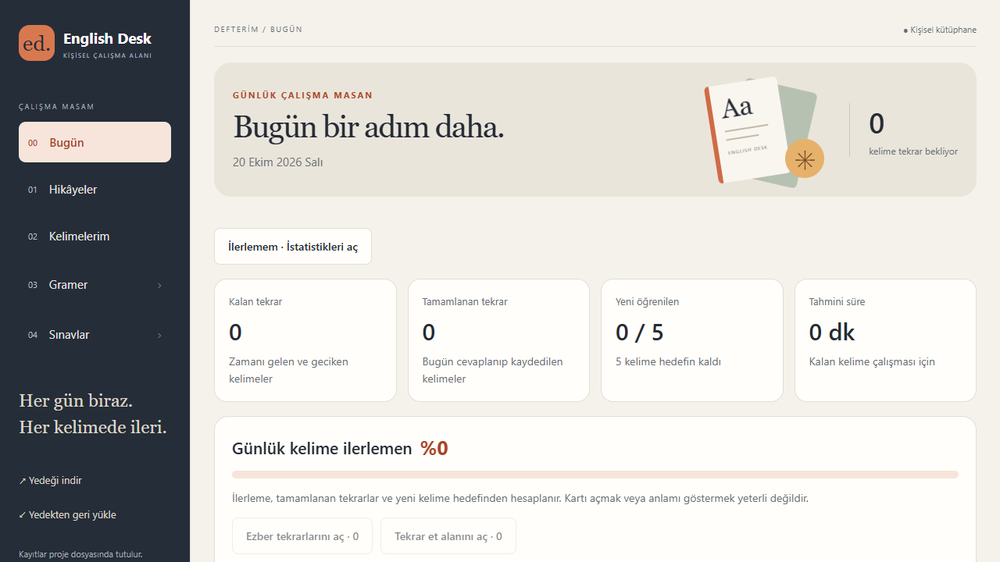

<div align="center">

# English Desk

**Her gün biraz. Her kelimede ileri.**

Hikâyelerden kelime topla, aktif hatırlamayla çalış, gramerini pekiştir ve ilerlemeni kendi kayıtlarınla takip et.

[](https://github.com/Teknoloji-Filozoflari/English-Desk/actions/workflows/ci.yml)
[](https://github.com/Teknoloji-Filozoflari/English-Desk/actions/workflows/docker.yml)


[Hızlı kurulum](#docker-ile-hızlı-kurulum) · [Özellikler](#çalışma-alanların) · [Yedekleme](#verilerin-ve-yedeklerin) · [Belgeler](#belgeler) · [Geliştirme](#geliştirme-ve-doğrulama)

</div>



English Desk, React Native ve Expo ile geliştirilen kişisel İngilizce çalışma defteridir. Bilgisayarda yerel web uygulaması olarak çalışır; Docker ile kurulduğunda bilgisayarına ayrıca Node.js veya Python yüklemen gerekmez.

**Yeni kurulum boş bir defterle başlar.** Görseller ve testler örnek kayıtlar kullanır. Depo ve Docker imajı kişisel hikâyelerini, kelimelerini, seslerini veya yedeklerini içermez.

## Docker ile hızlı kurulum

Docker Desktop veya Docker Engine + Compose kurulu ve çalışıyor olmalı. Repoyu klonla:

```sh
git clone https://github.com/Teknoloji-Filozoflari/English-Desk.git
cd English-Desk
docker compose up -d --build --wait
```

Git kullanmıyorsan **Code → Download ZIP** ile indir, arşivi aç ve proje klasöründe son komutu çalıştır.

Uygulamayı aç: **[http://127.0.0.1:8081](http://127.0.0.1:8081)**

İlk derleme internet bağlantısı gerektirir. Defter, sesler ve yedekler container dışında kalıcı Docker volume'lerinde tutulur. Sonraki açılışta:

```sh
docker compose up -d --wait
```

### Port doluysa

`Docker.env.example` dosyasını `.env` adıyla kopyalayıp portu değiştir:

```dotenv
ENGLISH_DESK_PORT=8091
```

`docker compose up -d --build --wait` çalıştır; **http://127.0.0.1:8091** adresini aç. Yerel başlatıcıyla açtığın 8081 sürümüyle Docker sürümü farklı veri depoları kullanır; geçiş için ZIP yedeğini aktar.

### Hazır imaj indirmek istersen

[GitHub Releases](https://github.com/Teknoloji-Filozoflari/English-Desk/releases) sayfasında istediğin sürümün **Docker** yayınına bak. Yeni `0.2.0` imajı yalnız GitHub'daki container testleri geçince yayımlanır; eski `0.1.0` indirmesi yeni özellikleri içermez.

Yayının `english-desk-linux-amd64.tar.gz` ve `SHA256SUMS` dosyalarını indir. Arşivi yükle ve başlat:

```sh
docker load -i english-desk-linux-amd64.tar.gz
docker run -d --name english-desk --init --restart unless-stopped -p 127.0.0.1:8081:8081 -v english-desk-data:/app/data -v english-desk-translation:/app/.runtime -v english-desk-python:/app/.venv english-desk:docker
```

Hazır imaj **Linux amd64** içindir; x86_64 Windows/macOS üzerinde Docker Desktop ile çalıştırılır. ARM cihazlarda kaynak kodundan Compose derlemesini kullan. Doğrudan `docker run` ve Compose örnekleri farklı volume adları kullanır.

[Docker kurulumu, doğrulama, taşıma ve sorun giderme →](docs/DOCKER.md)

## Çalışma alanların

| Alan                | Neler yapabilirsin?                                                                                                                                |
| ------------------- | -------------------------------------------------------------------------------------------------------------------------------------------------- |
| **Bugün**           | Bekleyen ve tamamlanan tekrarları gör; günlük yeni kelime hedefini değiştir; çalışma ekranlarına doğrudan geç.                                     |
| **Hikâyeler**       | PDF, TXT veya Markdown ekle; seviyeye göre ara/filtrele; okundu işaretle; kayıtlı ses ve cümle zamanlamalarıyla çalış.                             |
| **Kelimelerim**     | Hikâyeden kelime ve ifade kaydet; çoklu anlam, özgün kaynak cümle, kendi örneklerin, etiket ve fiil çekimlerini aynı kartta tut.                   |
| **Ezber**           | Seçtiğin kelimeleri ilk öğrenme tarihine bağlı **1, 3, 7, 14, 30 ve 60. günlerde** tekrar et.                                                      |
| **Kelime testleri** | Klasik kart, İngilizce→Türkçe, Türkçe→İngilizce, yazılı cevap ve cümleden boşluk doldurma modlarıyla çalış.                                        |
| **Gramer**          | Tense, Modality ve kişisel başlıklarda not tut; kural hatırlama, örnek seçme ve cümle tamamlama alıştırmaları yap.                                 |
| **Sınavlar**        | Test hazırla, çalışma/deneme modunu kullan, yarım oturuma devam et; yanlışlarını yeniden çöz ve haftalık karma mini sınav yap.                     |
| **İstatistikler**   | İlk öğrenme ve başarılı tekrarı ayrı izle; doğru cevap oranını, zorlandığın içerikleri, günlük/haftalık hedefleri ve kayıtlı sınav sürelerini gör. |
| **Aktarım**         | CSV/TSV dosyasını önizle ve sütunları eşleştir; onayla içe aktar; CSV, TSV veya Anki metni olarak dışa aktar.                                      |

### İlk çalışma günün

1. **Hikâyeler** bölümünden bir metin ekle veya **Kelimelerim → + Kelime ekle** ile kart oluştur.
2. Karttaki **Ezbere ekle** düğmesini kullan. **Ezber → Ezberlenecekler** içinde çalışıp **Ezberledim** ile başlangıç gününü kaydet.
3. **Bugün** panelindeki tekrar kısayollarını kullan. Kartı açmak veya cevabı görmek yeterli değildir; cevabını kaydettiğinde sayaçlar güncellenir.
4. **Bugün → İlerlemem · İstatistikleri aç** ile kaydedilmiş çalışma geçmişini incele.

Gecikmiş ezber tekrarlarında gerçek cevap günü saklanır; ilk öğrenme gününe bağlı takvim kaymaz ve günde bir adım tamamlanır. Ezber dışındaki **Tekrar et** alanı mevcut ayrı aralık motorunu kullanır.

Hikâyeden kaydedilen ifadenin özgün cümlesi korunur. Aynı ifade farklı hikâyelerde geçtiğinde kaynaklar birlikte saklanır. Phrasal verbs, collocations, farklı anlamlara ait örnekler ve kişisel cümleler desteklenir.


**Alt başlıkları yönet** ile gramer ve sınav başlıklarını düzenleyebilirsin. Başlığı silmek içerikleri silmez: notlar **Genel konular**, testler **Genel testler** altında kalır. Gramer/yanlış soru tekrarları ayrı geçmişe yazılır; eski sınav sonuçları değiştirilmez.

## Verilerin ve yedeklerin

**Yedeği indir → Tam yedek → Sesleri de ekle** ile taşınabilir ZIP yedeği al. **Yedekten geri yükle** dosyayı önce inceler; **Mevcutlara ekle** veya yalnız seçtiğin bölümleri değiştirme yöntemini seçip onaylarsın.

| Kayıt                                       | Nerede tutulur?                                                |
| ------------------------------------------- | -------------------------------------------------------------- |
| Defter, çalışma geçmişi, hedefler, sınavlar | Docker'da `notebook-data` volume'ü → `/app/data/notebook.json` |
| Önceki otomatik defter sürümleri            | Aynı volume içinde `/app/data/backups/`                        |
| Hikâye sesleri                              | Aynı volume içinde `/app/data/story-audio/`                    |
| İsteğe bağlı çeviri ortamı                  | `translation-runtime` ve `translation-python` volume'leri      |
| Docker dışında yerel web                    | Proje klasöründeki `data/` dizini                              |

`docker compose down` verileri korur. **`docker compose down -v` volume'leri ve kayıtları siler; normal durdurma veya güncellemede kullanma.** Docker kurulumu yeni bir defter açıyorsa eski kurulumundan tam ZIP yedeği alıp geri yükle.

CSV/TSV kelime aktarımı tam yedek değildir; çalışma geçmişi, sınav sonuçları ve sesler için JSON/ZIP kullan. ZIP sınırı 2 GB, JSON içeriği sınırı 20 MB'dır. Yedekler şifrelenmez. İçe aktarma önizleme ve onay olmadan mevcut kayıtları topluca değiştirmez.

### Güncelleme ve durdurma

Güncellemeden önce uygulamadan tam ZIP yedeği al. Compose kurulumu için:

```sh
git pull --ff-only
docker compose up -d --build --wait
```

Durdurmak veya durumu görmek için:

```sh
docker compose down
docker compose ps
docker compose logs --tail=100 english-desk
```

ZIP ile kurduysan yeni kaynak arşivini ayrı klasöre açıp Docker rehberindeki taşıma adımlarını kullan. Volume adlarını değiştirmenin farklı bir veri deposu açabileceğini unutma.

## Çevrimdışı kullanım ve platformlar

- Yerel sunucu açıkken kayıtlı içerik ve çalışma akışları internet gerektirmez. Sunucusuz PWA, bulut hesabı veya otomatik cihaz senkronizasyonu yoktur.
- Docker imajında temel yerel kaynaklar vardır. Argos Türkçe çeviri modeli ayrıca kurulur; bazı sözlük sorguları kelimeyi internet servislerine gönderir. PDF metin çıkarma cihazda yapılır.
- Android/iOS kaynakları ve JavaScript derlemeleri vardır; **hazır APK/IPA bulunmaz**. Native sürümde JSON paylaşımı vardır; PDF, ZIP/ses aktarımı ve ses oynatımı web ile sınırlıdır.
- Anki uyumluluğu metin CSV/TSV aktarımıdır; **`.apkg` paketleri desteklenmez**.
- Uygulamada hesap/giriş sistemi yoktur. Varsayılan Docker portu yalnız `127.0.0.1` üzerinden açılır; kişisel yerel kullanım içindir.

İki pencere aynı defteri değiştirirse eski revizyonla yazma reddedilir; sayfayı yenileyip güncel kayıttan devam et. Dosya okunamayacak kadar bozulduysa uygulama içi geri yükleme de revizyonu okuyamaz: bozuk dosyayı ve yedekleri koruyarak ayrı dosya kurtarma gerekir.

[Platform ayrımları ve bilinen sınırlar →](docs/PLATFORMS-AND-SYNC.md)

## Docker kullanmadan çalıştırma

**Windows:** `Baslat.cmd` dosyasını aç. **Linux x64:** `sh Baslat.sh` çalıştır. İlk kurulum internet gerektirir; yerel sunucu çalışırken uygulamayı kullanabilirsin.

Node.js 24+ ve npm hazırsa:

```sh
npm ci
npm run build:web
npm run preview
```

**http://127.0.0.1:8081** adresini aç. Expo geliştirme sunucusu (`npm run web`) tek başına dosya kayıt ve ZIP API'sini sağlamaz; bunlar için `npm run preview` gerekir.

[Yeni bilgisayara kurulum](YENI-PC-KURULUM.txt) · [Sözlük ve çeviri](SOZLUK-VE-CEVIRI.md)

## Geliştirme ve doğrulama

```sh
npm ci
npm run typecheck
npm test
npm run build:web
npx playwright install chromium
npm run test:e2e
npm run check:native
```

Derleme ve uçtan uca testleri sırayla çalıştır. Kurulu Chrome için PowerShell'de `$env:PLAYWRIGHT_CHANNEL = 'chrome'` ayarla. `check:native` yalnız Android/iOS JavaScript çıktılarını denetler; kurulabilir paket üretmez.

20 Ekim 2026 yerel son kalite kontrolünde **221 birim/entegrasyon ve 158 masaüstü/mobil tarayıcı testi geçti**. TypeScript, web ve native JavaScript derlemeleri başarılıydı. Fiziksel cihaz testi yapılmadı. Ayrıntılar ve bilinen eksikler: [teslim raporu](docs/DELIVERY-REPORT.md).

GitHub **CI** workflow'u tip, birim, web/native derleme ve tarayıcı kontrollerini çalıştırır. **Docker** workflow'u imajı derler; yerel API, veri volume'ü, yeniden oluşturma ve yedekleme testlerinden sonra yeni sürümün amd64 arşivini yayımlar. Yayımlanan sürüm tekrar yazılmaz; yeni yayın için uygulama sürümü artırılır.

## Belgeler

| Rehber                                                      | Kapsam                                                     |
| ----------------------------------------------------------- | ---------------------------------------------------------- |
| [Docker](docs/DOCKER.md)                                    | Kurulum, hazır imaj, port, taşıma, çeviri ve sorun giderme |
| [Günlük panel](docs/DAILY-STUDY.md)                         | Hedefler, sayaçlar ve süre tahmini                         |
| [Tekrar sistemi](docs/REPETITION-INTEGRITY.md)              | Sabit takvim, kalıcılık ve veri bütünlüğü                  |
| [Kelime testleri](docs/WORD-PRACTICE.md)                    | Modlar, cevap değerlendirme ve tekrar kaydı                |
| [Bağlam ve ifadeler](docs/CONTEXT-LEARNING.md)              | Kaynak cümleleri, çoklu anlam ve kişisel örnekler          |
| [Gramer ve sınav tekrarları](docs/GRAMMAR-EXAM-LEARNING.md) | Yanlışlar, gramer alıştırmaları ve haftalık karma          |
| [İstatistikler](docs/LEARNING-PROGRESS.md)                  | Gerçek geçmiş, tekilleştirme ve ölçüm sınırları            |
| [Kelime aktarımı](docs/WORD-TRANSFER.md)                    | CSV/TSV, eşleştirme, yinelenenler ve Anki metni            |
| [Arayüz](docs/UI-POLISH.md)                                 | Mevcut tema korunarak yapılan iyileştirmeler               |

## Lisans ve katkı

Copyright © 2026 English Desk contributors. Kaynak kodu [GNU GPL 3.0 veya sonraki sürümleri](LICENSE) altında sunulur (`GPL-3.0-or-later`). Yerel dil kaynakları kendi lisanslarını korur: [WordNet](resources/WORDNET-LICENSE.txt), [CEFR-J / Octanove](resources/cefr/README.md), [Words-CEFR-Dataset](resources/cefr/Words-CEFR-Dataset-LICENSE.txt).

Bir sorun bildirirken ekranı, beklediğin davranışı ve tekrar etme adımlarını [Issues](https://github.com/Teknoloji-Filozoflari/English-Desk/issues) üzerinden paylaşabilirsin. Kişisel defterini veya yedeklerini eklemene gerek yoktur.
