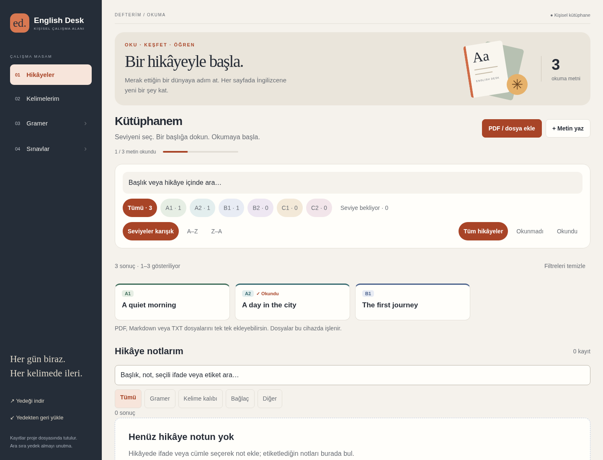
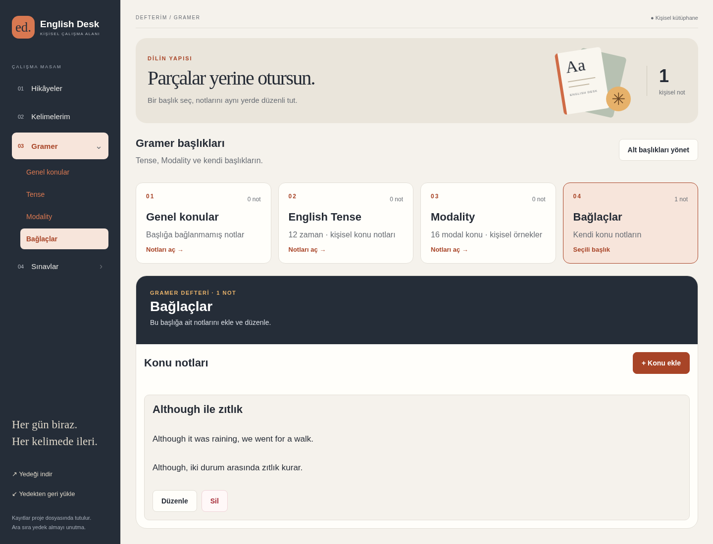

<div align="center">

# English Desk

**İngilizce çalışman için kişisel bir masa.**

Hikâyelerini oku, kelimelerini biriktir, gramer notlarını düzenle ve sınavlarla ilerlemeni takip et.

[](https://github.com/Teknoloji-Filozoflari/English-Desk/actions/workflows/ci.yml)


[Kurulum](#kurulum) · [Özellikler](#özellikler) · [Yedekleme](#yedekleme-ve-geri-yükleme) · [Geliştirme](#geliştirme)

</div>



English Desk, React Native ve Expo ile geliştirilmiş bir İngilizce çalışma defteridir. Bilgisayarda yerel web uygulaması olarak çalışır. Hikâyeler, kelime kartları, gramer notları ve sınav sonuçları aynı çalışma alanında tutulur.

**Yeni kurulum boş bir defterle başlar.** Depoda kişisel hikâye koleksiyonu, sınav soruları, ses arşivi veya kullanıcı yedekleri bulunmaz. Ekran görüntülerinde yalnızca örnek çalışma verileri kullanılır.

## Özellikler

| Çalışma alanı | Neler yapabilirsin? |
| --- | --- |
| **Hikâyeler** | PDF, TXT veya Markdown’dan metin ekle; A1–C2 seviyelerine ayır; ara, filtrele ve okundu işaretle. Ses dosyalarıyla çalış, cümle zamanlamalarını kaydet. |
| **Kelimelerim** | Hikâyeden kelime ve ifade seç; Türkçe anlam, İngilizce açıklama, birden fazla anlam, örnek, çeviri ve fiil çekimlerini aynı kartta tut. Seviyelere göre çalış ve tekrarlarını takip et. |
| **Gramer** | Tense, Modality ve kendi konu başlıklarında not tut. Başlık oluştur, adını değiştir, sil; notları başka başlıklara taşı. |
| **Sınavlar** | ÖSYM, IELTS veya kendi başlıkların altında test hazırla. Çalışma ve deneme modlarını kullan; yarım kalan oturuma devam et, sonuçlarını incele ve yanlışlarını tekrar et. |

Hikâyede seçtiğin cümleye gramer, kalıp, bağlaç veya diğer türde not ekleyebilir; notlarını etiketleyip arayabilirsin. Okuma ayarları ve çalışma ekranlarının tercihleri ekran değiştirdiğinde korunur.

### Gramer ve konu düzeni



**Alt başlıkları yönet** ile kendi gramer ve sınav başlıklarını oluşturabilirsin. Gramer başlıkları aynı kart düzeninde gösterilir; kartlarda not sayısı görünür. Not veya test düzenleyicisindeki **Alt başlık** seçimiyle içerikleri taşıyabilirsin.

Tense rehberinde 12 zaman, Modality bölümünde 16 konu başlangıçta hazırdır. Konuyu açınca kişisel not ekleme, düzenleme ve silme düğmeleri görünür. **Konu başlığını sil** başlığı kaldırır ve notlarını Genel konular’a taşır. Kaldırılan rehber başlıklarını yeniden ekleyebilirsin.

Başlık silmek içerikleri silmez: gramer notları **Genel konular**, testler ve oturumlar **Genel testler** bölümüne taşınır. Bir notun veya testin kendi silme düğmesi ilgili kaydı kaldırır; işlem öncesinde onay gösterilir.

## Kurulum

### Windows ve Linux

Depoyu indir veya klonla:

```sh
git clone https://github.com/Teknoloji-Filozoflari/English-Desk.git
cd English-Desk
```

- **Windows:** `Baslat.cmd` dosyasına çift tıkla.
- **Linux x64:** Proje klasöründe `sh Baslat.sh` çalıştır.

Başlatıcı gerekli Node.js ortamını ve npm bağımlılıklarını hazırlar, web uygulamasını derler ve tarayıcıyı açar:

**http://127.0.0.1:8081**

İlk kurulum internet bağlantısı gerektirir. Çeviri kurulumu ek indirme ve disk alanı kullanır; başarısız olursa uygulama yine açılır. Hazır kurulumda kayıtlar ve yerel kaynaklar çevrimdışı kullanılabilir. İnternet sözlüğü sorguları bağlantı gerektirir. Sunucu penceresini açık tut; kapatmak için `Ctrl+C` kullan.

### Node.js ile elle çalıştırma

Node.js **24 veya üzeri** ve npm gerekir:

```sh
npm ci
npm run build:web
npm run preview
```

Bu yol yerel kayıt ve yedekleme API’sini de başlatır. Türkçe çeviriyi ayrıca hazırlamak için:

```sh
npm run setup:translation
```

Kurulum ayrıntıları: [Yeni bilgisayara kurulum](YENI-PC-KURULUM.txt) · [Sözlük ve çeviri](SOZLUK-VE-CEVIRI.md).

## Yedekleme ve geri yükleme

**Yedeği indir** ekranında tam yedek veya dört bölümden istediğin birleşimi seçebilirsin. Bilgisayardaki web sürümü ZIP indirir; hikâye seslerini dahil etme seçeneği vardır.

| Bölüm | Yedeğe dahil olanlar |
| --- | --- |
| Hikâyeler | Metin, seviye, okundu durumu, kaynak adı, hikâye notları, ses zamanlamaları ve seçilirse MP3 dosyaları. |
| Kelimeler | Kartların bütün alanları, ek anlamlar, örnekler, kaynaklar, tekrar bilgileri ve hikâye bağlantı bilgileri. |
| Gramer | Notlar, kullanıcı başlıkları ve kaldırılan Tense/Modality başlıklarının ayarları. |
| Sınavlar | Testler, sorular, cevap anahtarları, konu başlıkları, oturumlar ve sonuçlar. |

**Yedekten geri yükle** dosyayı önce inceler. Bölümleri ve yükleme yöntemini seçtikten sonra eklenecek, atlanacak ve silinecek kayıt sayılarını görürsün:

- **Mevcutlara ekle:** Mevcut kayıtlar korunur; tekrarlanan kayıtlar atlanır.
- **Seçili bölümleri değiştir:** Yalnızca seçtiğin bölümlerin içeriği yedekle değiştirilir.

Eksik sesler ve eşleşmeyen hikâye bağlantıları bildirilir. Aynı adlı kullanıcı başlıkları eşleştirilir. Eski tam JSON yedekleri ve hikâye, kelime, sınav veya tam kurtarma ZIP arşivleri desteklenir.

ZIP sınırı **2 GB**, JSON içeriği sınırı **20 MB**’dır. Android/iOS cihaz sürümü JSON paylaşır; ZIP ve ses aktarımı yerel web sürümündedir.

## Verilerin nerede tutulur?

| Konum | İçerik |
| --- | --- |
| `data/notebook.json` | Kişisel defter ve sınav oturumları. |
| `data/backups/` | Kayıt değişikliklerinden önceki otomatik defter sürümleri. |
| `data/story-audio/` | Hikâye sesleri. |
| `data/dictionary-cache/`, `data/example-cache/` | Yerel sorgu önbellekleri. |
| `.runtime/`, `.venv/` | Başlatıcı ve çeviri ortamı. |

Kişisel veriler, önbellekler, yedekler ve kurulum çıktıları Git tarafından yok sayılır. Yeni klonda uygulama boş defteri oluşturur. Android/iOS kayıtları cihazın kendi depolamasındadır.

Başka bilgisayara geçerken sesleri dahil eden tam ZIP yedeği al ve yeni kurulumda geri yükle. Otomatik JSON sürümleri ses arşivinin yerini tutmaz. Ayrıntılar: [Yerel veri notu](data/README.md).

### Sözlük ve çeviri

Kelime seviyeleri yerel CEFR kaynaklarından bulunur; elle seçilen seviyeler korunur. WordNet temel İngilizce açıklamaları sağlar. Free Dictionary API ve Datamuse eksik sözlük alanlarını tamamlayabilir. Kuruluysa Argos, İngilizce açıklamaları ve örnekleri bu bilgisayarda Türkçeye çevirir.

Sözlük sorguları kelimeyi ilgili servise gönderir. PDF’den metin çıkarma cihazda yapılır. Dolu kart alanları otomatik tamamlama sırasında korunur. Veri kaynakları ve lisansları [sözlük notunda](SOZLUK-VE-CEVIRI.md) açıklanmıştır.

## Geliştirme

```sh
npm ci
npm run typecheck
npm test
npm run build:web
npm run preview
```

Expo web geliştirme sunucusu için `npm run web` kullanılabilir; bu sunucu tek başına yerel dosya kayıt API’sini sağlamaz. Kayıt, ses ve ZIP akışlarını doğrulamak için derlenmiş web sürümünü `npm run preview` ile aç.

### Tarayıcı testleri

```sh
npx playwright install chromium
npm run test:e2e:build
```

Linux’ta tarayıcının sistem bağımlılıkları eksikse `npx playwright install --with-deps chromium` kullan. Web derlemesi güncelse `npm run test:e2e` yeterlidir.

Playwright testleri masaüstü ve mobil Chromium görünümünde çalışır. Her test çalıştırması **8082** portunda geçici defter oluşturur; kişisel defteri ve seslerini kullanmaz. Gerçek dosya kayıt API’siyle yedekleme, geri yükleme, sınav devamlılığı, başlık yönetimi, not silme ve kayıt hataları doğrulanır.

GitHub Actions, `main` güncellemelerinde ve pull request’lerde testleri, TypeScript kontrolünü, web derlemesini ve tarayıcı akışlarını çalıştırır.

### Proje yapısı

```text
App.tsx                    Uygulama giriş noktası
src/notebook/
  screens/                 Kütüphane, okuyucu, kelime ve gramer ekranları
  components/              Menü, düzenleyiciler ve ortak arayüz
  hooks/                   Kayıt, yedekleme ve çalışma akışları
  services/                Form doğrulama ve kayıt işlemleri
src/model.ts               Defter modeli ve doğrulama
src/backup-core.ts         Bölüm seçimi ve geri yükleme kuralları
src/ExamDesk.tsx            Test hazırlama ve sınav oturumları
scripts/serve.mjs          Yerel web sunucusu ve API
scripts/backup-*.mjs        ZIP aktarımı ve yedekleme API’si
resources/                 Yerel sözlük ve seviye kaynakları
tests/                     Veri ve tarayıcı testleri
docs/images/               Örnek arayüz görüntüleri
```

Uygulama kodunu biçimlendirmek için `npm run format:app` kullan.

### Platform kapsamı

Bilgisayardaki yerel web sürümü temel kullanım yoludur. Android/iOS aynı React Native ekranlarını ve veri modelini kullanır; native cihaz doğrulaması ayrıca gerekir. Bu depoda hazır APK, IPA veya Windows/macOS masaüstü kurulum paketi bulunmaz.

PDF içe aktarımı web sürümünde **20 MB / 150 sayfa / 100.000 karakter** sınırlarıyla çalışır. OCR yoktur; yalnızca taranmış görsellerden oluşan PDF’ler metne çevrilmez. Native sürümde TXT/Markdown içe aktarımı vardır.

### Yerel koleksiyon aktarımı

Lingua PDF klasörünü içe aktarmak için `pdftotext` gerekir. Önce değişiklik yapmadan sonucu incele:

```sh
npm run import:lingua -- --source "/dosya/yolu/Lingua/A1" --level A1 --dry-run
```

`--dry-run` kaldırıldığında araç otomatik yedek alır ve kayıtları ekler. Kişisel koleksiyon dosyaları depoya dahil edilmez.

## Kaynaklar

Yerel dil kaynaklarının kendi lisansları korunur: [WordNet lisansı](resources/WORDNET-LICENSE.txt), [CEFR-J ve Octanove kaynak bilgileri](resources/cefr/README.md), [Words-CEFR-Dataset lisansı](resources/cefr/Words-CEFR-Dataset-LICENSE.txt).

Bir sorun bildirirken hangi ekranda olduğunu, beklenen davranışı ve hatayı tekrar etme adımlarını [Issues](https://github.com/Teknoloji-Filozoflari/English-Desk/issues) üzerinden paylaşabilirsin. Kişisel yedeklerini veya defter içeriğini eklemene gerek yoktur.
